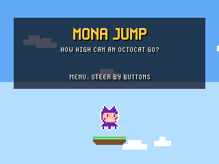
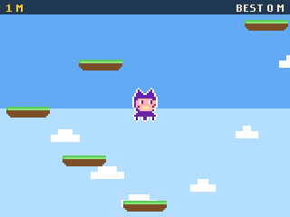
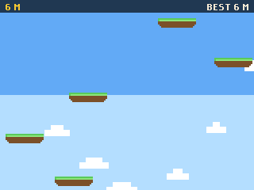
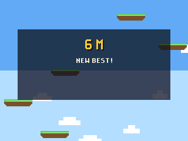

# Mona Jump for the GitHub Universe 2026 badge

A tilt-to-steer platform climber for the GitHub Universe 2026 badge: bounce ever higher and see how high an Octocat can go.

| Title | First Bounces | Climbing | Game Over |
| --- | --- | --- | --- |
|  |  |  |  |

Mona is drawn the way the badge's own apps draw her: white outline, purple
fur, peach face, two-pixel eyes and tentacles.

## Install

1. Put the badge in USB Disk Mode (open the Mass Storage app, or double-tap
   RESET) so the `BADGER` volume appears.
2. Copy the `apps/mona_jump` folder into `BADGER/apps/` (so you end up with
   `BADGER/apps/mona_jump/__init__.py`).
3. If your badge still runs the stock event menu, its tiles ignore `icon.png`.
   The [hyb26 skill](https://github.com/badger/home/tree/main/.github/skills/hyb26-skill)
   ships `patch_menu_icons.py`, which adds that support (with a backup).
4. Eject the volume. The badge restarts into the menu with a Mona Jump tile.

Scores are saved under `/state`. No network or extra hardware is needed.

## Controls

| Button | Action |
| --- | --- |
| Tilt, or Left / Right | Steer; Mona wraps around the screen edges |
| Select | Start; jump again after a fall |
| Menu | Switch between tilt and button steering (title screen) |
| Back | Back to the title |

## How it works

- Platforms are generated above the camera as it scrolls, with gaps and the share of sliding and crumbling platforms growing with height; some solid platforms carry a spring that launches Mona much higher.
- Landing is detected only while falling, when Mona's feet cross a platform top within the frame. The camera scrolls whenever she climbs past the upper third of the screen, and the height in metres is the score.
- Falling off the bottom ends the climb; the badge keeps the best height and the number of climbs.

The sprites are drawn from pixel maps by `tools/build_sprites.py`
(`python3 tools/build_sprites.py jump apps/mona_jump/assets`).

## Tools

- `tools/build_sprites.py` regenerates the sprite sheets.
- `tools/badge_harness.py` (with `tools/badge_kit.py` copied to `/state/kit.py`
  on the badge) drives the app's frame loop on a real badge over `mpremote
  run`, simulating button presses and saving run-length encoded screenshots
  to `/state/shots`; `tools/rle2png.py` converts them.

Mona is GitHub's Octocat mascot; this is a fan project and not affiliated
with GitHub.
